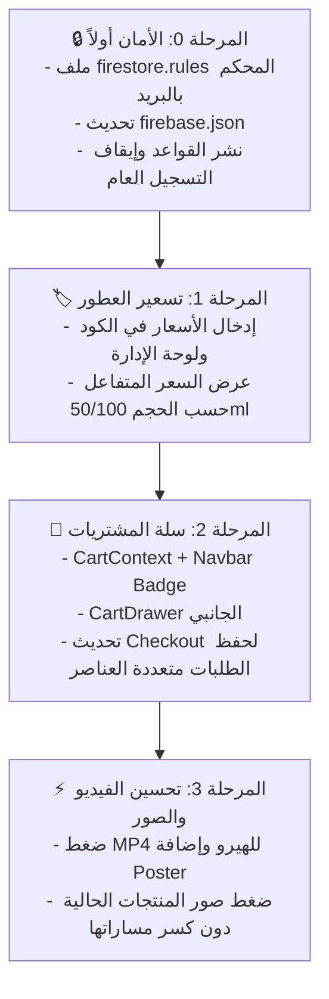

# 🛡️ خطة العمل المحدثة: تأمين Firebase وتحديثات متجر RAIHANA (الإصدار المحكّم)

> **تاريخ التحديث:** نوفمبر 2026  
> **المبدأ الحاكم:** الأمان الصارم أولاً (Zero Trust / Principle of Least Privilege) قبل أي خطوة برمجية.

---

## 🔒 المرحلة 0: الأمان أولاً وتأمين Firestore (Security First)

### 1. معالجة ثغرة التحقق من الإدارة `isAdmin()`

- **الخلل في الصيغة القديمة:** الاعتماد على `request.auth != null` يعني أن أي شخص يسجل حساباً بأي وسيلة (أو عبر Anonymous Login إن فُعّل) يعتبره Firestore مديراً ولديه صلاحية حذف المتجر بالكامل!
- **الحل المعتمد الصارم:**
  - التحقق بالاسم من البريد الإلكتروني للمدير الفعلي (أو الـ UID الخاص به):
    ```javascript
    function isAdmin() {
      return (
        request.auth != null &&
        request.auth.token.email in ["amohamedamr99@gmail.com"]
      );
    }
    ```
  - **إجراء يدوي في Firebase Console:** إيقاف التسجيل العام (Disable Public Sign-ups) في Firebase Auth لضمان عدم إنشاء أي حسابات جديدة إلا من طرفك مباشرة.

---

### 2. تحصين وحماية قاعدة إنشاء الطلبات (`orders create`)

لمنع إرسال حقول خبيثة، أو التلاعب بحالة الطلب، أو حقن نصوص ضخمة:

1. **اشتراط الحالة المبدئية:** يجب أن تكون `status == 'Pending'` فقط (يُمنع العميل من جعل طلبه `Completed`).
2. **تحديد الحقول المسموحة حصراً (`hasOnly`):** منع أي حقول عشوائية مجهولة.
3. **تقييد الحجم والكميات (Validation Limits):**
   - الاسم: نصوص بين 2 و 100 حرف.
   - الهاتف: نصوص بين 8 و 25 رقماً/حرفاً.
   - العنوان: نصوص بين 3 و 300 حرف.
   - عدد عناصر السلة: مصفوفة بحد أقصى 30 عنصراً (`items.size() <= 30`).
   - المبالغ المالية: أرقام موجبة (`totalAmount >= 0`).

---

### 3. الصياغة الرسمية لملف `firestore.rules`

```javascript
rules_version = '2';
service cloud.firestore {
  match /databases/{database}/documents {

    // 1. دالة التحقق الصارم من بريد الأدمن
    function isAdmin() {
      return request.auth != null &&
             request.auth.token.email in ['amohamedamr99@gmail.com'];
    }

    // 2. المنتجات (عطور، معطرات، بخور)
    match /perfumes/{perfumeId} {
      // قراءة عامة للزوار - الكتابة والتعديل والحذف مقصورة حصرياً على الأدمن
      allow read: if true;
      allow write: if isAdmin();
    }

    // 3. إعدادات المتجر (الهاتف، رسوم الشحن، الرسائل)
    match /settings/{settingId} {
      allow read: if true;
      allow write: if isAdmin();
    }

    // 4. طلبات الشراء (حماية فائقة لخصوصية بيانات العملاء)
    match /orders/{orderId} {
      // ممنوع منعاً باتاً قراءة أو سرد أي طلبات إلا للأدمن الموثق
      allow read: if isAdmin();

      // شروط إنشاء الطلب للعميل:
      allow create: if
        // حصر الحقول المسموحة فقط
        request.resource.data.keys().hasOnly([
          'customerName', 'customerPhone', 'customerAddress', 'city', 'notes',
          'items', 'subtotal', 'shippingCost', 'totalAmount', 'status', 'createdAt',
          // حقول التوافق القديمة (Single product checkout)
          'productId', 'productNameEn', 'productNameAr', 'size', 'price'
        ])
        // إلزامية أن تكون الحالة Pending عند الإنشاء
        && request.resource.data.status == 'Pending'
        // التحقق من صحة بيانات العميل
        && request.resource.data.customerName is string
        && request.resource.data.customerName.size() >= 2
        && request.resource.data.customerName.size() <= 100
        && request.resource.data.customerPhone is string
        && request.resource.data.customerPhone.size() >= 8
        && request.resource.data.customerPhone.size() <= 25
        && request.resource.data.customerAddress is string
        && request.resource.data.customerAddress.size() >= 3
        && request.resource.data.customerAddress.size() <= 300
        // في حال وجود عناصر سلة
        && (!('items' in request.resource.data) || (
            request.resource.data.items is list &&
            request.resource.data.items.size() > 0 &&
            request.resource.data.items.size() <= 30
        ))
        // التحقق من المبالغ إن وُجدت
        && (!('totalAmount' in request.resource.data) || (
            request.resource.data.totalAmount is number &&
            request.resource.data.totalAmount >= 0
        ));

      // التعديل والحذف حصرياً للأدمن
      allow update, delete: if isAdmin();
    }

    // إغلاق أي مسارات أخرى تماماً
    match /{document=**} {
      allow read, write: if false;
    }
  }
}
```

---

## 🛡️ استراتيجية منع التلاعب بأسعار الطلبات (Price Tampering Protection)

بما أن الطلب يُرسل من المتصفح (Client-side)، فإن العميل قد يتلاعب بالمبالغ في الـ Payload قبل الإرسال. لحل هذه المعضلة بنسبة 100%:

1. **في لوحة تحكم الأدمن (`Admin.jsx`):**
   - عند عرض أي طلب في لوحة الإدارة، نقوم بحساب الإجمالي المتوقع تلقائياً بناءً على أسعار العطور الحقيقية المسجلة في Firestore.
   - إذا وُجد فرق بين الإجمالي المرسل والإجمالي الفعلي، تظهر علامة تحذير بارزة باللون الأحمر: **`⚠️ تنبيه: تم رصد اختلاف في السعر!`**
2. **خطوة تأكيد الواتساب:**
   - لن يتم شحن أي طلب إلا بعد مراجعة تفاصيل الأصناف وحسابها النهائي مع العميل عبر الواتساب، وبذلك لا يمكن لأي متلاعب تمرير طلب بسعر غير حقيقي.

---

## 🏷️ المرحلة 1: نظام تسعير العطور (Perfume Pricing)

> **سبب تقديمها قبل الميديا:** استقرار بنية المنتجات والأسعار يضمن عدم كسر أي بيانات أو إعاقة عمل السلة والدفع.

1. **تحديث البيانات الأساسية `src/data/perfumes.js`:**
   - تحديد أسعار رسمية لكل عطر (سعر العبوة 50ML وسعر 100ML).
2. **لوحة الإدارة `Admin.jsx`:**
   - دعم تعديل الأسعار مباشرة لكل منتج وحجم في Firestore.
3. **واجهات المتجر:**
   - **بطاقة المنتج (`ProductCard.jsx`):** عرض السعر الأساسي أو "يبدأ من X جنيه".
   - **صفحة تفاصيل العطر (`ProductDetails.jsx`):** تغيير السعر فورياً عند اختيار حجم (50ml / 100ml).

---

## 🛒 المرحلة 2: نظام سلة المشتريات (Add to Cart System)

1. **إدارة الحالة (`CartContext.jsx`):**
   - حفظ عناصر السلة في `localStorage`.
   - دعم دوال الإضافة والحذف وتعديل الكميات وحساب الإجمالي.
2. **عناصر الواجهة (UI):**
   - عداد السلة الفاخر في `Navbar.jsx`.
   - نافذة السلة الجانبية (`CartDrawer.jsx`) بحركات Framer Motion وتصميم متناسق مع هوية ريحانة.
3. **تحديث صفحة الدفع (`Checkout.jsx`):**
   - دعم إرسال طلب مجمع يحوي مصفوفة `items` مع تفاصيل كل عطر وحجمه وكميته وسعره.

---

## ⚡ المرحلة 3: تحسين الميديا والأداء (Media Optimization)

> **تنبيه تم اعتماده:** تجنب تحويل الامتدادات فجأة الذي قد يكسر المسارات المسجلة في قواعد البيانات، والاعتماد على MP4 H.264 عالي الضغط بعد ثبوت أنه أخف من WebM في التجربة العملية.

1. **فيديو الهيرو (`Hero Video`):**
   - ضغط ملف `women.mp4` الحالي (2.4MB) باستخدام ترميز H.264 ذكي ليصل إلى أقل من **800KB** دون فقدان الوضوح.
   - إبقاء الامتداد بصيغة `.mp4` كما هو لتفادي أي مشاكل توافقية.
   - إضافة صورة Poster خفيفة تظهر فورياً قبل بدء الفيديو لمنع أي شاشة سوداء.
2. **صور المنتجات والخلفيات:**
   - ضغط الصور الكبيرة (مثل `img4.png`, `img5.png`, `img6.png` التي تقترب من 2MB) مع الحفاظ على امتداداتها ومساراتها السليمة لتفادي كسر الروابط المخزنة في Firestore.
   - تطبيق ضغط بدون فقدان جودة وتصغير الأبعاد لتناسب مقاسات العرض الفعلي في المتصفح.

---

## 📊 الترتيب الزمني للتنفيذ المعتمد


